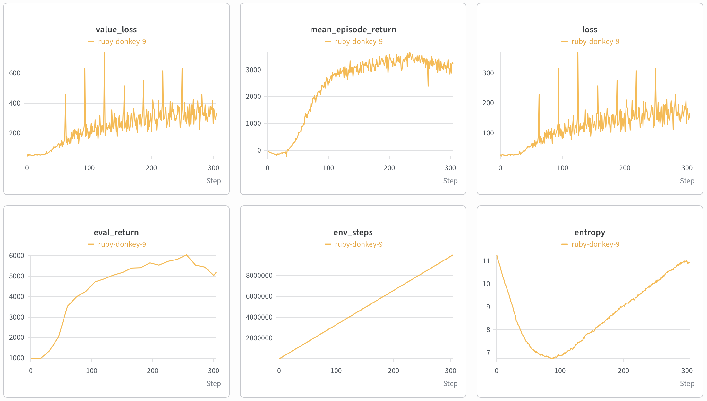

# Implementation of a Massively Parallel PPO Agent: From Theory to Production


## 1. Abstract & Objective

This project is a scalable, production-ready implementation of the Proximal Policy Optimization (PPO) algorithm utilizing the JAX ecosystem and the Brax physics engine. The primary objective is to transition academic reinforcement learning concepts into a highly performant industrial pipeline.

Instead of static datasets, the pipeline dynamically generates experience through the highly parallelized continuous control `ant` environment. By leveraging JAX's `vmap` for environment vectorization and `jit` for end-to-end compilation of the update step, the training loop efficiently processes 10,000,000 environment steps in under 3 minutes on a single NVIDIA T4 GPU. The architecture strictly decouples data collection, loss computation, and weight updates, minimizing memory allocations and maximizing computational throughput.

## 2. Architecture & Mathematical Formulation

The model consists of several key modules designed to stabilize on-policy learning and efficiently balance state-space discovery with reward maximization:

### 2.1 PPO Clipped Surrogate Objective

The agent optimizes a clipped surrogate objective function to prevent catastrophic policy degradation caused by excessively large weight updates. The final objective maximizes the expected return, minimizes the Value Function error ($L_{VF}$), and incentivizes exploration via an entropy bonus ($S$):

$$L(\theta) = \hat{\mathbb{E}}_t \left[ \min\left( r_t(\theta)\hat{A}_t, \text{clip}(r_t(\theta), 1-\epsilon, 1+\epsilon)\hat{A}_t \right) - c_1 L_t^{\text{VF}} + c_2 S(\pi_\theta) \right]$$

where $r_t(\theta) = \frac{\pi_\theta(a_t|s_t)}{\pi_{\theta_{old}}(a_t|s_t)}$ is the probability ratio between the current and old policies, and $c_1$, $c_2$ correspond to the `vf_coef` and `ent_coef` hyperparameters.

### 2.2 Generalized Advantage Estimation (GAE)

To reduce variance while maintaining a low bias, Generalized Advantage Estimation is applied. The advantage estimate $\hat{A}_t$ is calculated recursively based on the Temporal Difference (TD) error $\delta_t$:

$$\hat{A}_t = \delta_t + (\gamma \lambda)\delta_{t+1} + \dots + (\gamma \lambda)^{T-t+1}\delta_{T-1}$$
$$\delta_t = r_t + \gamma V(s_{t+1}) - V(s_t)$$

### 2.3 Continuous Action Space & Normalization

- **Action Distribution:** The Actor network outputs parameters $\mu$ and $\log\sigma$, which parameterize a `distrax.MultivariateNormalDiag` distribution. A $\tanh$ squashing function is applied to constrain sampled actions within the $[-1, 1]$ environmental bounds, with a mathematically stable correction applied to the log-probabilities.
- **Welford's Algorithm:** To ensure stable neural network convergence, running means and variances (Welford's online algorithm) are utilized for real-time normalization of both observations and rewards.

## 3. Visualizations

The architecture's training dynamics are tracked in Weights & Biases. The charts below demonstrate the stable convergence of evaluation metrics during a fully compiled JAX training run on an NVIDIA T4 GPU.



*Figure 1: W&B Dashboard showing the `eval_return` successfully surpassing the 5000 threshold, steady `value_loss` minimization, and optimal `entropy` management (demonstrating successful exploration followed by controlled exploitation to prevent policy collapse).*

## 4. Evaluation Metrics & Results

Pipeline performance was evaluated using the deterministic Mean Evaluation Reward (`eval_return`) over 10,000,000 training steps across 1024 parallel environments. Training yielded the following results:

| Architecture | Environment | Steps | Eval Return (Validation) | Train Return | Computation Time |
| :--- | :--- | :--- | :--- | :--- | :--- |
| **PPO + Continuous + Welford Norm** | `ant` (1024 envs) | 10M | **~5224.34** | ~3211.08 | **~172 sec** |

### Training Dynamics Analysis
- **Convergence:** The algorithm robustly crosses the `eval_return > 5000` benchmark in fewer than 300 gradient updates.
- **Entropy Management:** Maintaining an `ent_coef = 0.01` successfully prevented premature convergence to sub-optimal policies.
- **Hardware Efficiency:** Offloading physical simulations and gradient descent operations directly to the XLA compiler via JAX `jit` and `vmap` yielded a throughput of tens of thousands of environment steps per second on a single GPU.

## 5. Quick Start

The project uses `uv` for ultra-fast dependency and virtual environment management. All routine operations are encapsulated within the `Makefile`.

```bash
# Clone the repository and install dependencies
git clone https://github.com/Pavelpuff/brax-ppo-pipeline.git
cd brax-ppo-pipeline
make setup

# Run the full-scale training suite (Production / GPU)
make train

# Alternatively, run isolated local debugging (CPU / Apple MPS)
JAX_PLATFORMS=cpu uv run python -m src.train --total_timesteps 100000 --num_envs 16
```